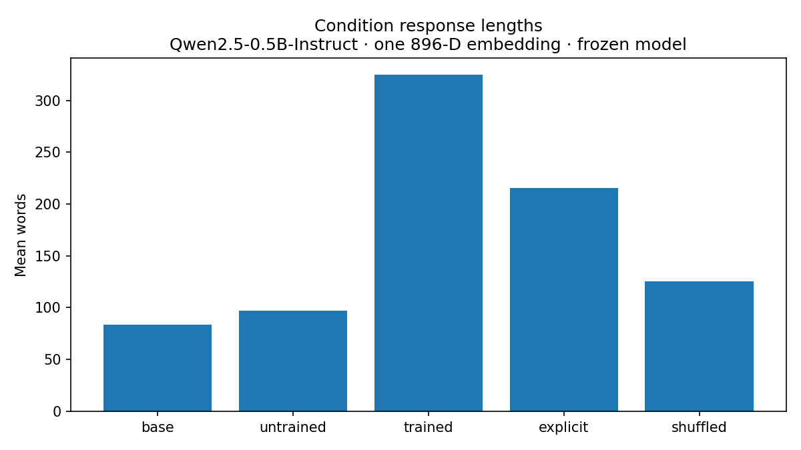
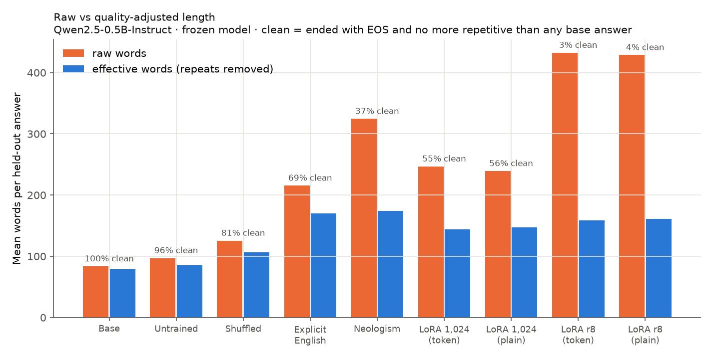
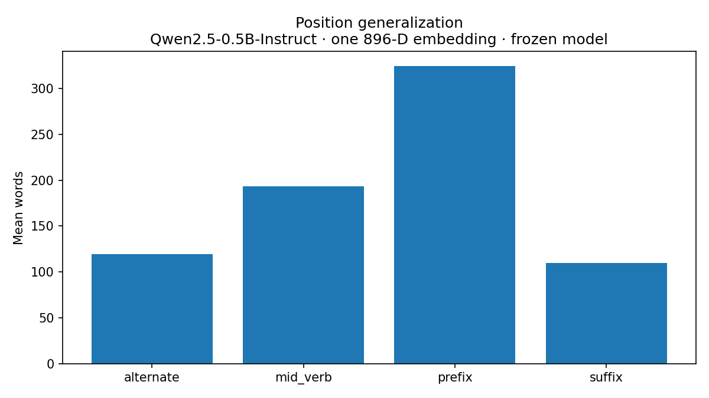
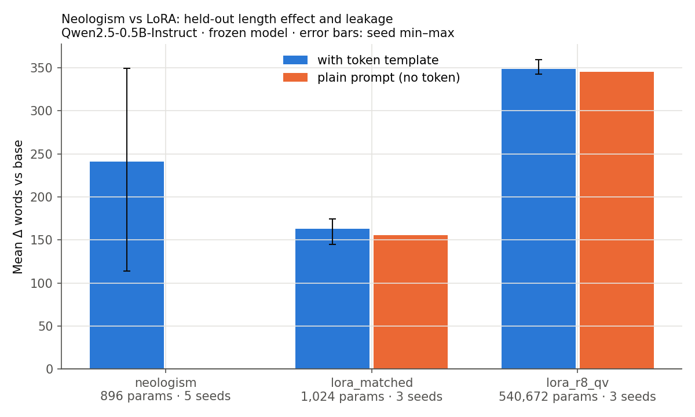
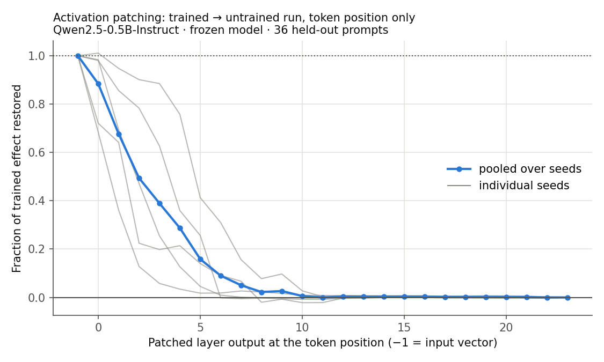
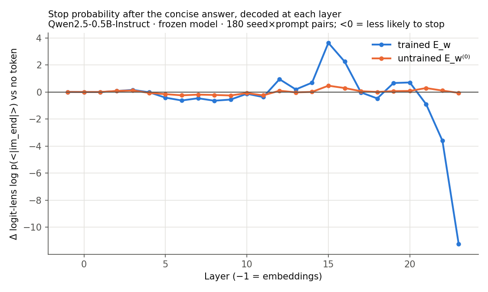

# Learning Behavioral Concepts as Single Token Embeddings in Frozen Language Models

[](https://github.com/BobbY-24/neologism-embedding-learning/actions/workflows/tests.yml)  


> Instead of fine-tuning an entire language model, can we add one new token and optimize only its embedding from preference pairs—and when does that embedding begin to behave like a reusable word rather than a soft control vector?

> **Status / Scope: work in progress.** Experiment 1, Experiment 2 (quick and **full multi-seed**), the LoRA baseline and the interpretability analyses are complete on `Qwen/Qwen2.5-0.5B-Instruct`, which serves as a development and mechanistic testbed. The full runs ran on a Colab GPU through [`notebooks/colab_runner.ipynb`](notebooks/colab_runner.ipynb). A within-family scale replication (Qwen2.5-1.5B and 3B) is implemented and CPU-tested but not run. Cross-family replication has not started. All results are within one 0.5B model and should not be generalized to language models broadly.

## Done vs pending

| Component | Code | Results |
|---|---|---|
| Experiment 1: 3-pair pilot | ✅ | ✅ `results/experiment_1/` |
| Experiment 2 quick mode (1 seed, 5 pairs, 10 prompts) | ✅ | ✅ `results/experiment_2/quick/` |
| Experiment 2 full mode (5 genuine + 3 shuffled seeds, 20 pairs, 36 prompts, learning curves) | ✅ | ✅ `results/experiment_2/full/` |
| LoRA baseline (matched 1,024-param arm + rank-8 arm, 3 seeds each) | ✅ | ✅ `results/experiment_2/full/lora_baseline/` |
| Interpretability: vocabulary neighbours, logit lens, activation patching | ✅ | ✅ `results/experiment_2/full/interp/` |
| Colab driver notebook | ✅ | n/a |
| CPU tests (tiny random Qwen2; no download) | ✅ in CI | n/a |
| Experiment 3: within-family scale (1.5B in fp32, 3B in bf16; frozen 0.5B data; full protocol) | ✅ | ⏳ not run; the 0.5B reference it compares against is now complete |
| Cross-family replication | ❌ | ❌ |

Every number below comes from a completed run. Experiment 3 is described in [docs/experiment_3.md](docs/experiment_3.md) and reports no numbers yet.

This repository is a controlled framework for studying the progression

```text
preference fitting → behavioral control → held-out generalization → word-like composition
```

while treating seed robustness, model scale, model family, and concept/task transfer as separate external-validity questions.

## The parameter bottleneck

The experiment adds one token, `<ENSURE_LONG>`, to a Qwen tokenizer and substitutes one independently trainable vector wherever that token occurs. The base embedding table and every transformer parameter stay frozen.

| Parameter group | Count |
|---|---:|
| Frozen Qwen parameters | 494,032,768 |
| **Trainable parameters** | **896** |

```text
Preference pairs
      ↓
DPO-style objective
      ↓
single new embedding E_w
      ↓
frozen Qwen testbed
      ↓
behavior on held-out prompts
      ↓
tests of syntax / compositionality / scale
```

The manually implemented objective is

\[
L=-\log \sigma\left(\beta\left[(\log p_{E_w}(y_c|x)-\log p_{E_w^{(0)}}(y_c|x))-(\log p_{E_w}(y_r|x)-\log p_{E_w^{(0)}}(y_r|x))\right]\right),
\]

with response-token log probabilities only. Optimization updates `E_w`; model parameters `θ_Qwen` are checksum-verified as unchanged.

## Current result: strong, token-specific control that degrades quality and is not word-like

Experiment 2 screened 100 prompts with base Qwen, kept 56 that it answered concisely, and froze a topic-disjoint 20-train / 36-held-out split. The **full run** trained the embedding on all 20 contrast-purified pairs, with **5 genuine initialization seeds** and **3 shuffled-label seeds**. It evaluated every condition on all 36 held-out prompts with greedy decoding and a 512-token cap, on a Colab CUDA GPU in fp32 (2026-10-20). The base outputs regenerated on the GPU matched the original CPU screening word for word on all 36 prompts.

| Condition | Mean held-out words | Δ vs base | Hit the 512-token cap |
|---|---:|---:|---:|
| Base | 83.7 | — | 0% |
| Untrained token | 97.1 | +13.4 | 2% |
| Shuffled-label token (3 seeds) | 125.6 | +41.9 | 3% |
| Explicit English instruction | 215.6 | +131.9 | 17% |
| **Trained token (5 seeds)** | **324.6** | **+240.9** | **47%** |



**Every seed works, but by different amounts.** All five genuine seeds lengthened 97–100% of held-out prompts. Their mean effects ranged about 3× (prompt-bootstrap 95% intervals):

| Seed | Final DPO loss | Δ words vs base | 95% CI |
|---:|---:|---:|---|
| 1 | 0.029 | +349.4 | [+335.5, +362.6] |
| 2 | 0.030 | +315.9 | [+287.2, +342.6] |
| 3 | 0.139 | +114.1 | [+84.7, +147.7] |
| 4 | 0.089 | +192.0 | [+148.8, +235.3] |
| 5 | 0.027 | +233.1 | [+189.3, +276.0] |

The weakest seeds are also the least-fitted (highest final loss). Over the 18 learning-curve runs (3 seeds × N = 0–20), preference margin and held-out effect correlate at r = 0.95; those points are not independent. The mean effect grows with data: +11.6, +11.0, +33.5, +81.4, +190.0 and +259.8 words at N = 0, 1, 2, 5, 10 and 20. The five learned vectors are nearly orthogonal (pairwise cosine 0.01–0.12), so many different directions produce the same behavior.

**Shuffled labels are a weaker but not null control.** Shuffled seeds reached a DPO loss of only 0.53–0.63, against 0.03–0.14 for genuine seeds, and lengthened outputs by +12.7 to +66.5 words. Part of the length effect therefore does not depend on correct preference labels.

### Caveat: much of the extra length is degenerate

The trained token beats the explicit English instruction on length (1.83× its effect), but this is not a quality win. 47% of trained outputs ran into the 512-token cap, and their text is far more repetitive:

| Condition | Repeated-trigram fraction | Repeated-sentence fraction | Lexical diversity |
|---|---:|---:|---:|
| Base | 0.054 | 0.000 | 0.609 |
| Explicit English | 0.147 | 0.018 | 0.460 |
| Trained token | 0.370 | 0.216 | 0.329 |

Degeneration tracks effect size. Seed 3 (+114 words) stays fairly clean (11% at the cap, trigram repetition 0.13), while seed 1 (+349) hits the cap 75% of the time with trigram repetition 0.53. Word count is therefore an upper bound on useful elaboration. The cap also truncates the largest effects.

### Quality-adjusted length: on par with plain English

`scripts/analyze_quality.py` re-scores the saved outputs without loading a model, using two stricter measures:

- **Effective words.** The number of distinct word trigrams + 2, i.e. what an answer would keep if every repeated three-word span were deleted. For text without repeats it equals the word count.
- **Clean answer.** One that ended with EOS rather than at the token cap, and is no more repetitive than the most repetitive base answer (repeated-trigram fraction ≤ 0.171). The threshold comes from the base condition, not from trained outputs.

| Condition | Raw Δ words | **Effective Δ words** | Clean answers | Effective ÷ explicit-English effect |
|---|---:|---:|---:|---:|
| Untrained token | +13.5 | +6.0 | 96% | 0.07 |
| Shuffled token | +42.0 | +27.8 | 81% | 0.30 |
| Explicit English | +131.9 | +91.4 | 69% | 1.00 |
| **Neologism (5 seeds)** | +240.9 | **+94.9** (seeds +73 to +118) | 37% | 1.04 |
| LoRA 1,024, token / plain | +163.2 / +155.6 | +65.0 / +67.9 | 55% / 56% | 0.71 / 0.74 |
| LoRA r8, token / plain | +348.8 / +345.2 | +79.5 / +82.1 | 3% / 4% | 0.87 / 0.90 |



Once repeats are removed, the 896-parameter token adds about as much non-repeated text as the explicit instruction (1.04×, not the 1.83× in raw words). It does this less cleanly: 37% of its answers are clean, against 69%. Per seed, the trade-off is visible. Seeds 1 and 2 have the largest raw effects but only 14% clean answers. Seed 3 is 75% clean and still adds +80.5 effective words. Neither LoRA arm beats the neologism on effective length, and both still leak to plain prompts. Effective length measures non-repetition only, not accuracy or relevance: some long, non-repeating outputs are fluent fabrications.

## Main negative result: syntax dominates

The same trained vectors behaved very differently when moved without retraining (5 seeds × 20 prompts per placement):

| Placement | Mean words |
|---|---:|
| Prefix (training syntax) | 324.2 |
| Mid-verb (`Please <ENSURE_LONG> your response…`) | 193.4 |
| Suffix | 110.1 |
| Alternate form (`I want you to <ENSURE_LONG> the answer.`) | 119.6 |



Relative to the same prompts' base outputs (84.5 words), the effect is +239.7 words at the prefix, +108.8 mid-verb, +35.0 in the alternate form and +25.5 as a suffix. Exploratory grammatical probes on a single prompt (`Could you <ENSURE_LONG> your answer?`, adjective use, and so on) averaged 88–156 words, against a base of 79. The vector acts as a position-bound control signal rather than a reusable word.

## LoRA baseline: comparable control, but it leaks everywhere

Same 20 pairs, DPO objective, template and 36 held-out prompts. The token stays at its untrained random vector and only low-rank adapters learn. The LoRA helpers are adapted from [qwen-lora-finetuning](https://github.com/BobbY-24/qwen-lora-finetuning). Learning rates are fixed (`experiments/experiment_2/configs/lora_baseline.json`) and were not tuned on held-out data.

| Method | Trainable params | Seeds | Δ words, token template | Δ words, plain prompt | Hit the cap | Trigram repetition |
|---|---:|---:|---:|---:|---:|---:|
| **Neologism** | **896** | 5 | **+240.9** (seeds +114 to +349) | **0** (by construction) | 47% | 0.37 |
| `lora_matched`: rank 1, layer-0 `v_proj` | 1,024 | 3 | +163.2 (+145 to +174) | +155.6 | 28% | 0.28 |
| `lora_r8_qv`: rank 8, q/v, all 24 layers | 540,672 | 3 | +348.8 (+343 to +360) | +345.2 | 93% | 0.61 |



- **Specificity is the neologism's distinctive property.** Both LoRA arms change behavior just as much on plain prompts without the token, so they rewrite the model's default behavior. The neologism changes nothing unless the token is present: logits on token-free prompts were bit-identical before and after training (max difference 0).
- **At a matched budget**, the 1,024-parameter LoRA fit the preferences less well (final loss 0.13–0.18, against 0.03–0.14 for the neologism) and produced a smaller, more uniform effect.
- **At 600× the budget**, rank-8 LoRA fit best (loss ≈ 0.02) but degenerated most: 93% of outputs hit the cap.

## Interpretability: where the learned token acts

Metric: the teacher-forced log p(`<|im_end|>`) right after the base model's own concise answer, which measures whether the model would stop where base Qwen stopped. The trained token lowered it on 100% of seed × prompt pairs, by a mean of **−11.2 nats** relative to the untrained token.

**Activation patching at the token position.** Starting from the untrained run, one layer's residual-stream output at the token position was restored from the trained run. Restoring the input vector brings back 100% of the effect by construction. Restoring layer outputs brings back 88% at layer 0, 49% at layer 2, 16% at layer 5 and ≤3% from layer 8 on (pooled over 5 seeds × 36 prompts). By about layer 10, later positions have read everything they need from the token position through attention. When this happens varies by seed, from layer ~3 (seed 1) to ~11 (seed 5).



**Logit lens at the stop decision.** Decoding each layer at the stop-decision position shows that the "don't stop" signal appears late. The trained-minus-no-token difference in stop log-prob stays within about ±1 nat through layer 14, is noisy in the middle layers, and drops to −0.9, −3.6 and −11.3 nats at layers 21, 22 and 23. The untrained token stays within ±0.5 nat throughout. The logit lens is only a rough readout of intermediate layers in a model this small, so the mid-layer values should not be over-read.



Together these suggest a two-stage picture. Information is read out of the token position early, in layers 0–8, and the change in the model's stopping behavior appears only in the last 2–3 layers. This is correlational at the stop position; only the token-position step was tested causally.

**Vocabulary neighbours.** The learned vectors are not near any length-related word. For every seed, the nearest input-embedding rows (tied with the unembedding in this model) are unrelated multilingual subwords at cosine ≤ 0.16, both for E_w itself and for the update E_w − E_w⁽⁰⁾. Their averaged update direction is not interpretable either. Together with the near-orthogonal seeds, this indicates that E_w works as an off-manifold control vector, not as a position in the model's lexical space.

## Evidence ladder

| Claim | Current evidence | Scope |
|---|---|---|
| Preference fitting | **Strong** | 5/5 seeds, loss 0.693 → 0.03–0.14 |
| Behavioral control | **Strong** in raw length; **matches explicit English** after removing repeats (+94.9 vs +91.4 effective words), with fewer clean answers (37% vs 69%) | 5 seeds × 36 held-out prompts |
| Held-out topic transfer | **Strong** | Topic-disjoint split, 97–100% of prompts per seed |
| Seed robustness | **Partial** | Direction robust; size varies 3×; vectors near-orthogonal |
| Token specificity vs LoRA | **Strong** | LoRA leaks fully to plain prompts; neologism cannot |
| Word-like compositional behavior | **Absent** | Effect collapses away from the training position |
| Where the token acts | **Preliminary** | Read out of the token position by ~layer 8; stop effect emerges in the final layers |
| Scale generalization | **Unknown** | 1.5B / 3B replication implemented, not yet executed |
| Cross-family generalization | **Unknown** | Qwen only |
| Richer concepts | **Unknown** | Length/elaboration only |

The earlier quick run (1 seed, 5 pairs, 10 prompts; `results/experiment_2/quick/`) pointed the same way at a smaller scale: +73.2 words, with strong position dependence.

Read [Experiment 1](docs/experiment_1.md), [Experiment 2](docs/experiment_2.md), [Experiment 3 (scale)](docs/experiment_3.md), [limitations](docs/limitations.md), and the [research roadmap](docs/research_roadmap.md) for the complete progression.

## Reproduce

Requirements: Python 3.10+, enough disk/RAM for the external checkpoint, and Git LFS is **not** required.

```bash
git clone https://github.com/BobbY-24/neologism-embedding-learning.git
cd neologism-embedding-learning

python -m venv .venv
source .venv/bin/activate
pip install -r requirements.txt
pip install -e .

bash scripts/download_model.sh
bash scripts/reproduce_quick.sh
```

The download script obtains the official `Qwen/Qwen2.5-0.5B-Instruct` checkpoint from Hugging Face into the ignored `models/` directory. Model weights are not part of this repository and remain governed by the upstream model provider's license. To use an existing local Transformers checkpoint instead:

```bash
QWEN_MODEL_PATH=/path/to/Qwen2.5-0.5B-Instruct bash scripts/reproduce_quick.sh
```

Experiment 2 is resumable and supports `screen`, `dataset`, `train`, `evaluate`, `positions`, `learning-curve`, `analyze`, and `all` stages:

```bash
python -m neologism_embedding.experiment2 --mode quick --stage analyze
python -m neologism_embedding.experiment2 --mode full --stage screen
```

### Full runs on Google Colab

The full multi-seed Experiment 2, the LoRA baseline and the interpretability analyses run on a Colab GPU:

1. Open [`notebooks/colab_runner.ipynb`](notebooks/colab_runner.ipynb) in Colab (File → Open notebook → GitHub → `BobbY-24/neologism-embedding-learning`) and choose a GPU runtime (L4 or A100).
2. Optional: add `HF_TOKEN` under 🔑 Secrets with notebook access. The model is public, and the token is never printed.
3. Run the cells top to bottom. Results go to `MyDrive/neologism-embedding-learning/outputs`, and each stage resumes after a disconnect.
4. The Phase 4 cell writes `results_full.zip` (CSV/JSON/PNG/summary only), which can be copied into `results/experiment_2/full/`.
5. Phase 5 is the scale replication. Set `SCALE_MODEL` to `qwen2.5-1.5b`, run the section, then repeat with `qwen2.5-3b`. It reuses the frozen 0.5B pairs and prompts, writes to `outputs/experiment_3/<model>-<dtype>/`, compares every finished size with the 0.5B run, and bundles `results_scale.zip`. The dataset and dtype choices are explained in [docs/experiment_3.md](docs/experiment_3.md).

The same scripts run anywhere with a checkpoint:

```bash
export QWEN_MODEL_PATH=models/Qwen2.5-0.5B-Instruct NEOLOGISM_OUTPUT_ROOT=outputs
python scripts/run_experiment2.py --mode smoke --stage all   # minutes; checks the pipeline, numbers meaningless
python scripts/run_experiment2.py --mode full --stage all
python scripts/run_interp.py --mode full
python scripts/run_lora_baseline.py --mode full
python scripts/make_figures.py --mode full

# Experiment 3: the same stages with NEOLOGISM_MODEL=qwen2.5-1.5b or qwen2.5-3b, then
python scripts/compare_scales.py --mode full
```

Full mode reuses the committed screening outputs and aborts if the train/held-out split it rebuilds differs from the frozen manifest. All conditions, base included, are generated in the same runtime, so they share one device and dtype.

Completed runs used a MacBook Pro M3 with 8 GB RAM on CPU, Python 3.13.3, PyTorch 2.13.0, and Transformers 5.15.0. Full-mode multi-seed training can take hours on this hardware.

## Repository map

```text
src/neologism_embedding/       frozen-model wrapper and experiment pipelines
  lora_baseline.py             LoRA arm with the same pairs and DPO objective
  interp.py                    neighbours, logit lens, activation patching
  figures.py                   interpretability and LoRA figures
  quality.py                   repetition-adjusted re-analysis of saved outputs (no model)
  scale.py                     Experiment 3 cross-size comparison
notebooks/colab_runner.ipynb   Colab GPU driver for the full runs
experiments/experiment_1/      3-pair pilot data and configuration
experiments/experiment_2/      100 candidates, frozen split, 20 prefix-purified pairs
experiments/experiment_3/      scale-replication model registry (0.5B, 1.5B, 3B)
results/experiment_1/          pilot metrics and diagnostics
results/experiment_2/quick/    completed quick-run metrics, figures, and examples
results/experiment_2/prepared_full_dataset/
                               prepared full split; no full behavioral results
docs/                          experiment narratives, limitations, and roadmap
tests/                         freezing, gradient, data, split, cache, LoRA, patching,
                               scale, figure and notebook checks (CPU, tiny random models)
```

## Origin and citation

This work is inspired by and experimentally extends the neologism proposal in John Hewitt, Robert Geirhos, and Been Kim, *We Can't Understand AI Using our Existing Vocabulary* (ICML 2025 position paper; [arXiv:2502.07586](https://arxiv.org/abs/2502.07586)). This repository is independent work and does not imply affiliation with the paper's authors.

To cite this work-in-progress research software, use [CITATION.cff](CITATION.cff).

## License

Repository code is available under the [MIT License](LICENSE). This license does not relicense Qwen or any externally downloaded model weights.

