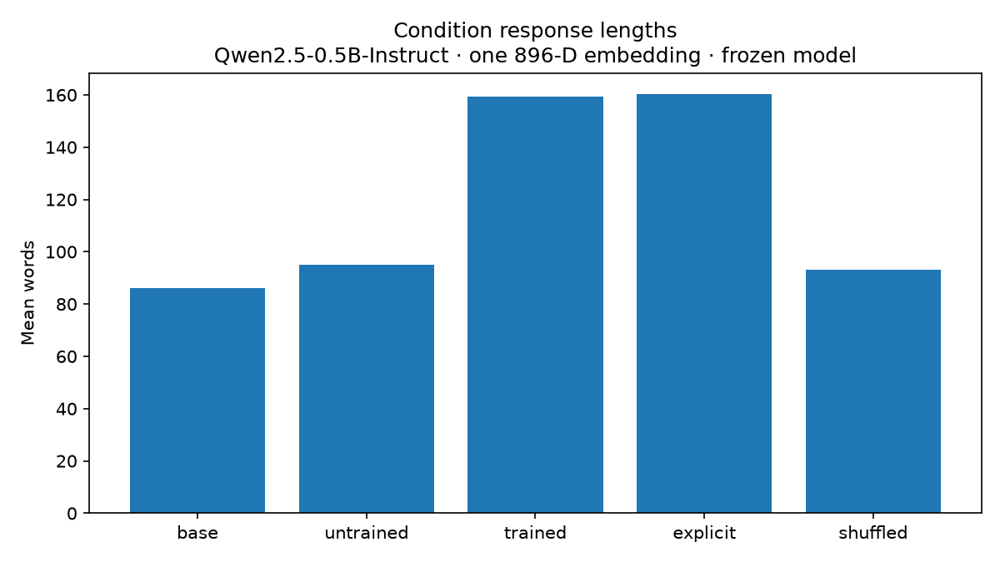
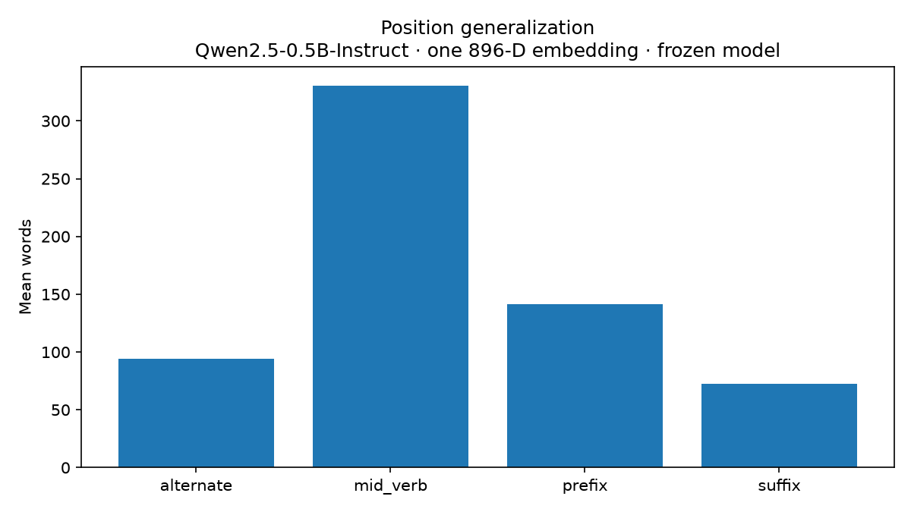

# Learning Behavioral Concepts as Single Token Embeddings in Frozen Language Models

> Instead of fine-tuning an entire language model, can we add one new token and optimize only its embedding from preference pairs—and when does that embedding begin to behave like a reusable word rather than a soft control vector?

> **Status / Scope — Work in progress.** Experiment 1 and Experiment 2 **quick mode** are complete on `Qwen/Qwen2.5-0.5B-Instruct`, used as a development and mechanistic testbed. Full multi-seed Experiment 2 and larger-model replications have **not** been completed. Current results establish within-model behavior only and should not be generalized to language models broadly.

This repository is a controlled framework for studying the progression

```text
preference fitting → behavioral control → held-out generalization → word-like composition
```

while treating seed robustness, model scale, model family, and concept/task transfer as separate external-validity questions.

## The parameter bottleneck

The experiment adds one token, `<ENSURE_LONG>`, to a Qwen tokenizer and substitutes one independently trainable vector wherever that token occurs. The base embedding table and every transformer parameter stay frozen.

| Parameter group | Count |
|---|---:|
| Frozen Qwen parameters | 494,032,768 |
| **Trainable parameters** | **896** |

```text
Preference pairs
      ↓
DPO-style objective
      ↓
single new embedding E_w
      ↓
frozen Qwen testbed
      ↓
behavior on held-out prompts
      ↓
tests of syntax / compositionality / scale
```

The manually implemented objective is

\[
L=-\log \sigma\left(\beta\left[(\log p_{E_w}(y_c|x)-\log p_{E_w^{(0)}}(y_c|x))-(\log p_{E_w}(y_r|x)-\log p_{E_w^{(0)}}(y_r|x))\right]\right),
\]

with response-token log probabilities only. Optimization updates `E_w`; model parameters `θ_Qwen` are checksum-verified as unchanged.

## Current result: measurable control, not a learned word

Experiment 2 first screened 100 prompts with base Qwen, retained 56 concise/EOS-terminated prompts, and froze a disjoint 20-train/36-held-out split. Its completed **quick run** used 5 exact-prefix preference pairs, 10 held-out prompts, one genuine initialization seed, and one shuffled-label seed.

| Condition | Mean held-out words |
|---|---:|
| Base | 86.0 |
| Untrained token | 94.9 |
| Shuffled token | 93.1 |
| **Trained token** | **159.2** |
| Explicit English | 160.4 |

The genuinely trained embedding increased output length by an average of **+73.2 words relative to base** and **+64.3 relative to the untrained token**. Eight of ten held-out prompts had a positive trained-minus-base difference; the prompt-bootstrap 95% interval was `[+35.5, +117.8]` words. Its mean effect was 0.984 of the explicit-English instruction effect, but that ratio is based on one small run and is not a general equivalence claim.



The controls matter. Genuine preferences reduced DPO loss from `0.693` to `0.124`; shuffled preferences reduced it only to `0.522`. The shuffled token averaged just **+7.1 words over base**. Optimization success and intended held-out behavioral meaning are distinct phenomena.

## Main negative result: syntax dominates

The same trained vector behaved very differently when moved without retraining:

| Placement | Mean words |
|---|---:|
| Prefix (training syntax) | 141.3 |
| Suffix | 72.3 |
| Mid-verb | 330.7 |
| Alternate form | 94.0 |



Some long generations were also repetitive: trained outputs had repeated-bigram fraction `0.207` versus `0.122` for base and `0.144` for explicit English; lexical diversity fell from `0.618` (base) to `0.505` (trained). The vector appears to encode a context-dependent tendency to continue or add material more strongly than a stable, high-quality lexical concept.

## Evidence ladder

| Claim | Current evidence | Scope |
|---|---|---|
| Preference fitting | **Strong** | Qwen2.5-0.5B testbed |
| Behavioral control | **Moderate** | One quick genuine seed |
| Held-out topic transfer | **Moderate, preliminary** | 10 prompts in the same model |
| Word-like compositional behavior | **Absent / weak** | Strong position dependence |
| Seed robustness | **Unknown** | Full multi-seed run not executed |
| Scale generalization | **Unknown** | No larger model tested |
| Cross-family generalization | **Unknown** | Qwen only |
| Richer concepts | **Unknown** | Length/elaboration only |

Read [Experiment 1](docs/experiment_1.md), [Experiment 2](docs/experiment_2.md), [limitations](docs/limitations.md), and the [research roadmap](docs/research_roadmap.md) for the complete progression.

## Reproduce

Requirements: Python 3.10+, enough disk/RAM for the external checkpoint, and Git LFS is **not** required.

```bash
git clone https://github.com/BobbY-24/neologism-embedding-learning.git
cd neologism-embedding-learning

python -m venv .venv
source .venv/bin/activate
pip install -r requirements.txt
pip install -e .

bash scripts/download_model.sh
bash scripts/reproduce_quick.sh
```

The download script obtains the official `Qwen/Qwen2.5-0.5B-Instruct` checkpoint from Hugging Face into the ignored `models/` directory. Model weights are not part of this repository and remain governed by the upstream model provider's license. To use an existing local Transformers checkpoint instead:

```bash
QWEN_MODEL_PATH=/path/to/Qwen2.5-0.5B-Instruct bash scripts/reproduce_quick.sh
```

Experiment 2 is resumable and supports `screen`, `dataset`, `train`, `evaluate`, `positions`, `learning-curve`, `analyze`, and `all` stages:

```bash
python -m neologism_embedding.experiment2 --mode quick --stage analyze
python -m neologism_embedding.experiment2 --mode full --stage screen
```

Completed runs used a MacBook Pro M3 with 8 GB RAM on CPU, Python 3.13.3, PyTorch 2.13.0, and Transformers 5.15.0. Full-mode multi-seed training can take hours on this hardware.

## Repository map

```text
src/neologism_embedding/       frozen-model wrapper and experiment pipelines
experiments/experiment_1/      3-pair pilot data and configuration
experiments/experiment_2/      100 candidates, frozen split, 20 prefix-purified pairs
results/experiment_1/          pilot metrics and diagnostics
results/experiment_2/quick/    completed quick-run metrics, figures, and examples
results/experiment_2/prepared_full_dataset/
                               prepared full split; no full behavioral results
docs/                          experiment narratives, limitations, and roadmap
tests/                         freezing, gradient, data, split, and cache checks
```

## Origin and citation

This work is inspired by and experimentally extends the neologism proposal in John Hewitt, Robert Geirhos, and Been Kim, *We Can't Understand AI Using our Existing Vocabulary* (ICML 2025 position paper; [arXiv:2502.07586](https://arxiv.org/abs/2502.07586)). This repository is independent work and does not imply affiliation with the paper's authors.

To cite this work-in-progress research software, use [CITATION.cff](CITATION.cff).

## License

Repository code is available under the [MIT License](LICENSE). This license does not relicense Qwen or any externally downloaded model weights.

